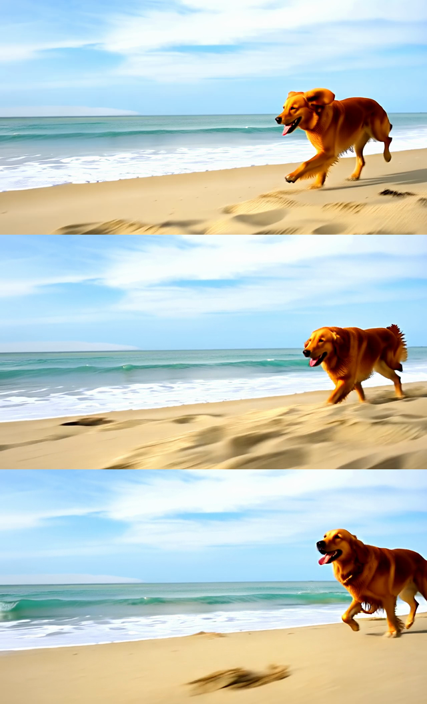

# Sample outputs

Unedited first outputs from the local media stack, generated on one RTX 4090 (24 GB) through llama-swap on
2026-11-02. Setup: [`install-comfyui.sh`](../install-comfyui.sh), [`dl-comfy-models.sh`](../dl-comfy-models.sh),
[`tts/`](../tts), [`llama-swap-media.yaml`](../llama-swap-media.yaml).

## Image: FLUX.2 Klein 4B (distilled, Apache 2.0)

1024×1024, 4 steps, Euler, CFG 1 — the bundled ComfyUI "Text to Image (FLUX.2 Klein 4B Distilled)" template,
run with [`comfy/comfy_run.py`](../comfy/comfy_run.py).

| | |
|---|---|
|  |  |
| *"A red fox sitting in fresh snow at dawn, soft golden light, detailed fur, photograph"* — seed 42 | *"A vintage red bicycle leaning against a blue wooden door, morning light"* — seed 7 |
| 23.7 s cold (llama-swap starting ComfyUI + loading the model) | **2.0 s** warm |

```bash
python3 comfy/comfy_run.py image "A red fox sitting in fresh snow at dawn, soft golden light, detailed fur, photograph" --seed 42
```

## Video: Wan 2.2 TI2V-5B (Apache 2.0)

[`wan22-5b-retriever.mp4`](wan22-5b-retriever.mp4) — 1280×704, 24 fps, 49 frames (~2 s), H.264. 20 steps, UniPC,
CFG 5, shift 8 (the bundled `video_wan2_2_5B_ti2v` template, text-to-video). **~58 s** including the model swap
from FLUX.

*"A golden retriever runs along a sunny beach, waves rolling in, camera tracking alongside"* — seed 42

Frames 0, 24 and 48:



```bash
python3 comfy/comfy_run.py video "A golden retriever runs along a sunny beach, waves rolling in, camera tracking alongside" --seconds 2 --seed 42
```

## Voice: Chatterbox (MIT)

[`chatterbox-hello.wav`](chatterbox-hello.wav) — default voice, 24 kHz mono, 4.6 s. 17.5 s cold (model load);
a warm request generates ~4.3 s of speech in **2.4 s** (faster than real time), using ~3.8 GB VRAM.

*"Hello from olympus. The local voice server is up and running on the RTX 4090."*

```bash
curl -s localhost:8080/v1/audio/speech -H "Authorization: Bearer $KEY" -H 'Content-Type: application/json' \
  -d '{"model":"chatterbox","input":"Hello from olympus. The local voice server is up and running on the RTX 4090."}' \
  -o hello.wav
```

Outputs are not cherry-picked: each is the first and only generation for its prompt.
